<p align="center">
  
</p>

<h1 align="center">Mitscreen</h1>

<p align="center">
  <strong>Công cụ chụp &amp; quay màn hình cá nhân, gọn và nhanh, cho Windows</strong><br>
  Chụp vùng / cửa sổ / toàn màn hình · chú thích tử tế · cắt bỏ đoạn thừa ở giữa rồi nối
  hai phần lại · quay một vùng thành MP4 — tất cả từ khay hệ thống, một thanh nổi
  truy cập nhanh, hoặc một phím tắt.
</p>

<p align="center">
  <a href="README.md">🇬🇧 English</a> ·
  <a href="INSTALL.md">Hướng dẫn cài đặt</a> ·
  <a href="CHANGELOG.md">Nhật ký thay đổi</a>
</p>

<p align="center">
  
  
  
  
  
</p>

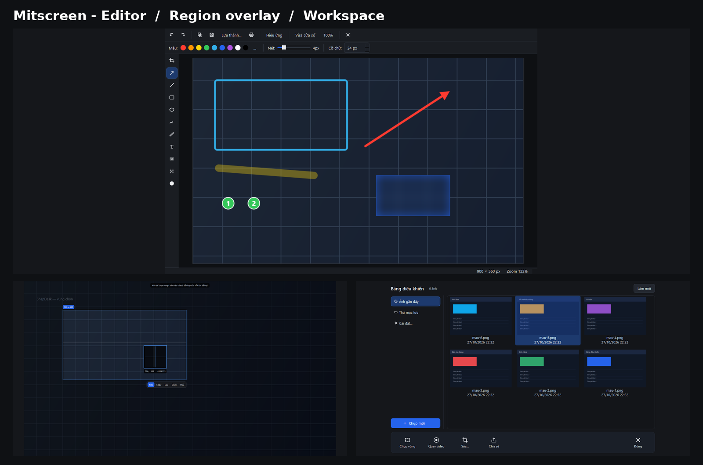

> Mitscreen là bản **viết lại độc lập từ đầu** bằng Python + Qt. Nó lấy cảm hứng từ
> *quy trình làm việc* (chụp → chú thích → chia sẻ) của các app chụp màn hình thương mại,
> nhưng **không dùng code, icon, asset, chuỗi hay license của họ**. Toàn bộ icon trong
> app — kể cả logo chữ “M” — đều được vẽ lúc chạy bằng `QPainter`.

---

## Hình ảnh

### Trình sửa — chú thích, làm mờ, đánh số, cắt & nối

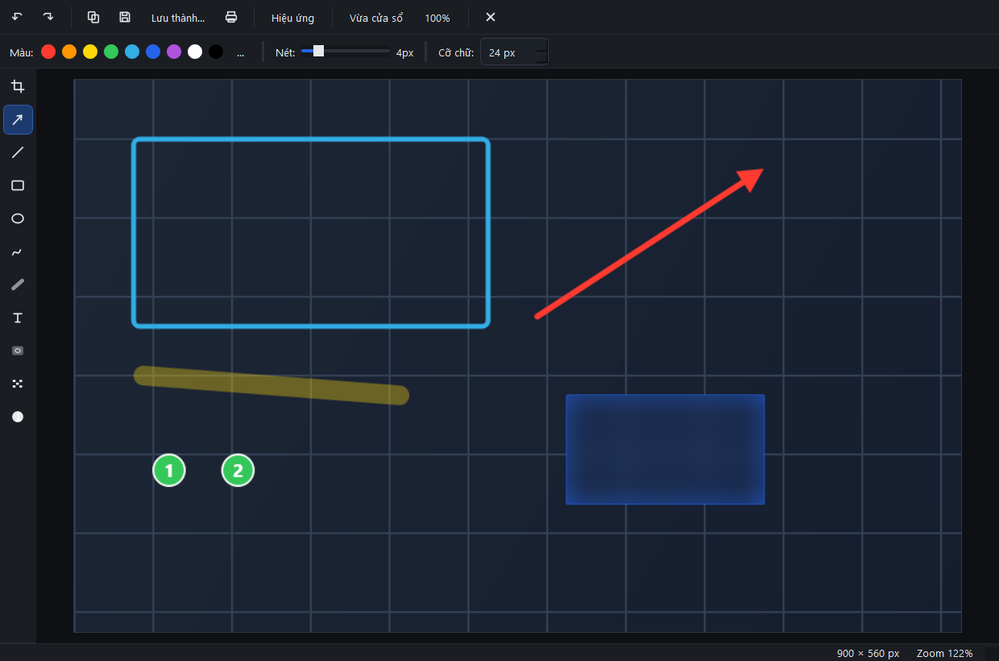

### Chọn vùng — màn hình đóng băng, kính lúp, mã màu trực tiếp

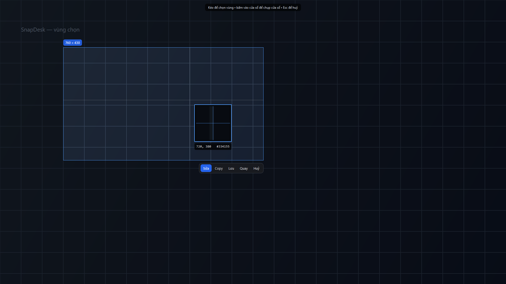

### Thanh truy cập nhanh — thanh nổi tự thu thành Người Nhện treo tơ

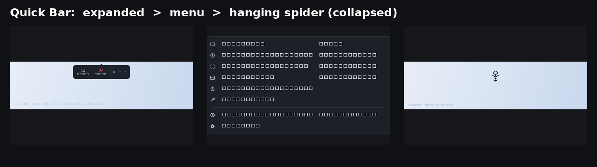

<table>
  <tr>
    <td align="center">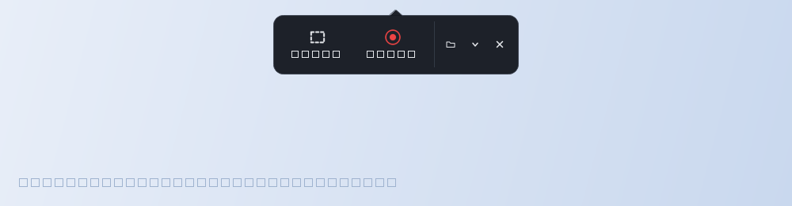<br><sub><b>Khi bung ra</b> — chụp vùng, quay video, mở thư mục, menu, ẩn</sub></td>
    <td align="center">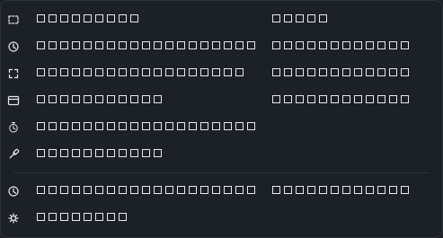<br><sub><b>Menu chức năng</b> — chụp lại vùng trước, hẹn giờ, bút lấy màu, bảng điều khiển…</sub></td>
    <td align="center">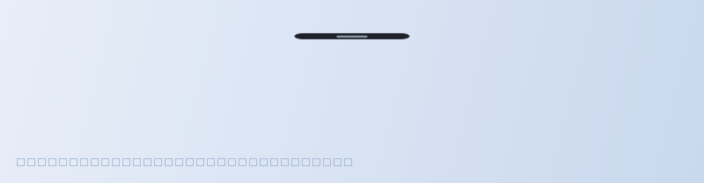<br><sub><b>Khi thu gọn</b> — một chú Người Nhện đen treo tơ, chỉ 72 × 78 px</sub></td>
  </tr>
</table>

### Bảng điều khiển — mọi ảnh đã chụp trong một cửa sổ

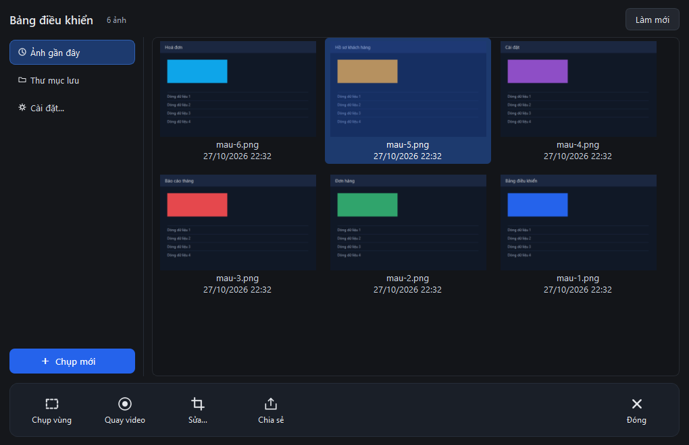

### Cài đặt — hành vi chụp, dung lượng và tên tệp ở một chỗ

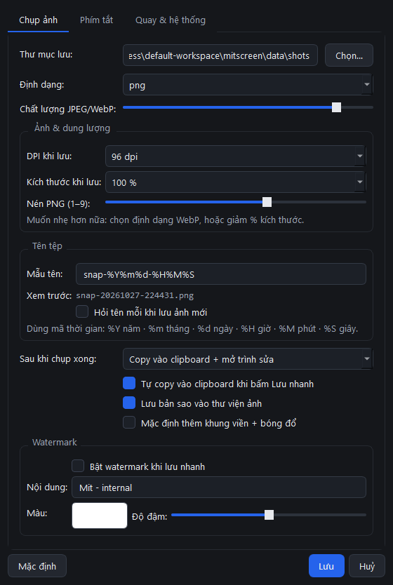

### Cắt bỏ & nối — bỏ một dải, hai phần tự dính vào nhau

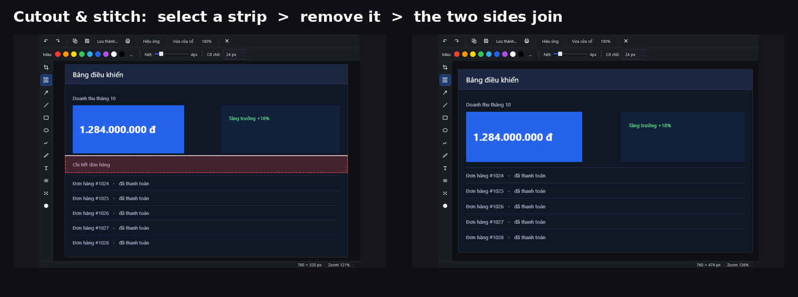

<table>
  <tr>
    <td align="center">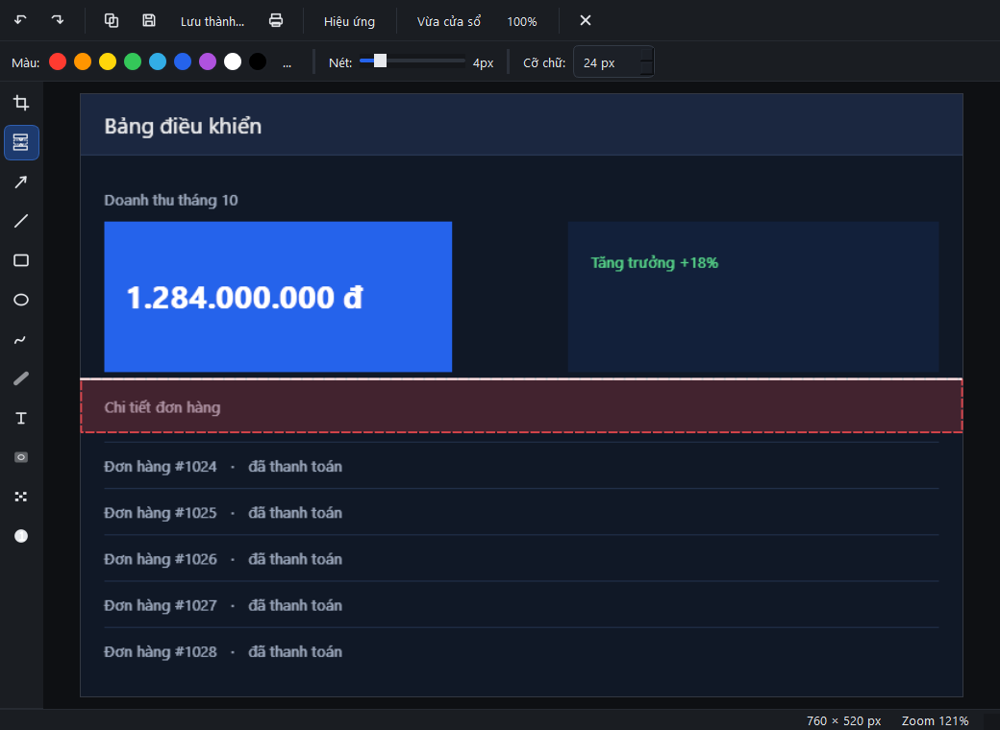<br><sub><b>Trước</b> — dải sắp bỏ được tô đỏ, trải hết chiều ngang</sub></td>
    <td align="center">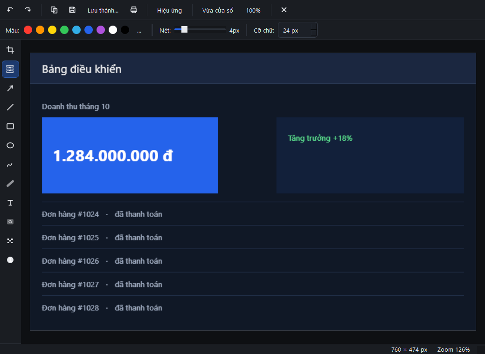<br><sub><b>Sau</b> — dải đã biến mất, hai phần nối liền nhau</sub></td>
  </tr>
</table>

### Quay video — khung đỏ nằm ngoài vùng ghi, không bao giờ lọt vào video

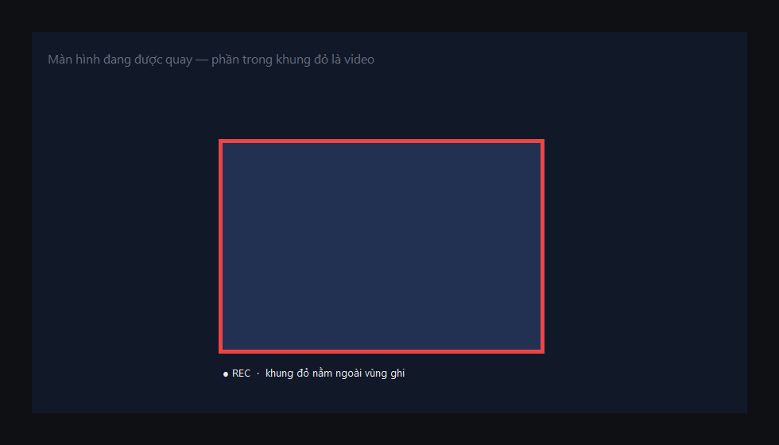

### Thư viện và icon ở mọi kích thước

<table>
  <tr>
    <td align="center">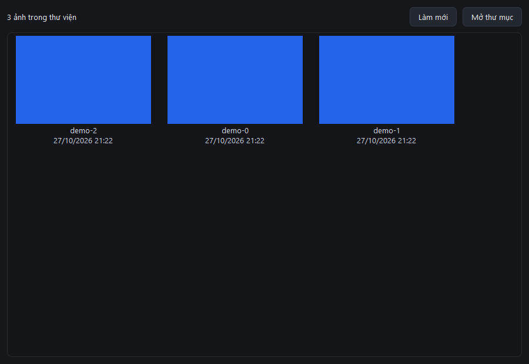<br><sub><b>Thư viện</b> — lưu theo tháng, kèm sidecar JSON</sub></td>
    <td align="center">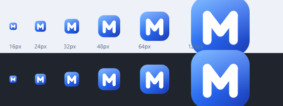<br><sub><b>Icon</b> — chữ “M” ở các cỡ 16, 24, 32, 48, 64, 128 px, trên nền sáng và tối</sub></td>
  </tr>
</table>

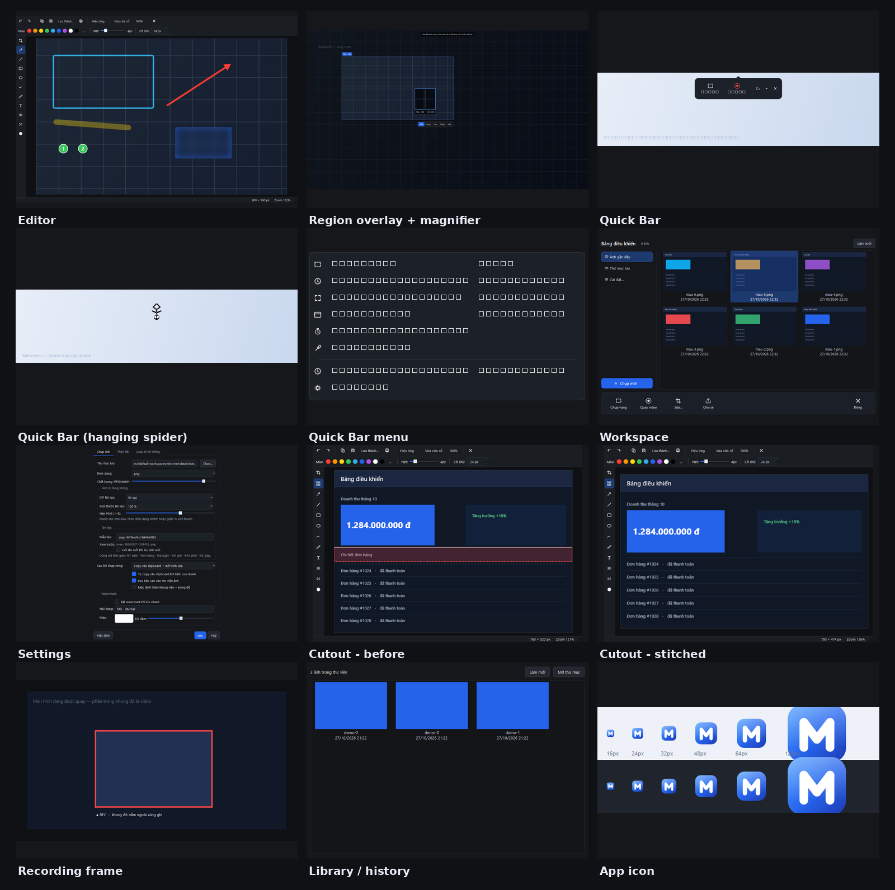

---

## Tính năng

| Nhóm | Có gì |
|---|---|
| **Chụp** | Vùng chọn (kéo chuột), cửa sổ (bấm vào cửa sổ), toàn màn hình, đa màn hình, chụp lại đúng vùng trước, chụp hẹn giờ 3 giây |
| **Kính lúp** | Khi chọn vùng: phóng to điểm đang trỏ, toạ độ tuyệt đối + mã màu hex dưới con trỏ |
| **Bút lấy màu** | Bấm lên bất cứ điểm nào trên màn hình để copy mã hex của pixel đó |
| **Sau khi chụp** | Mặc định: **copy vào clipboard + mở trình sửa** (không hiện thanh chọn). Đổi được sang *chỉ sửa* / *lưu ngay* / *hiện thanh chọn (Sửa / Copy / Lưu / Quay / Huỷ)* |
| **Thanh truy cập nhanh** | Thanh nổi: chụp vùng / quay video / mở thư mục / menu thêm / ẩn; kéo được, nhớ vị trí, tự thu thành Người Nhện treo tơ khi rảnh, tự ẩn khi đang chụp–quay |
| **Trình sửa** | Cắt ảnh, **cắt bỏ & nối**, mũi tên (4 kiểu: thường, hai đầu, đuôi chấm tròn, đậm đặc), đường thẳng, chữ nhật, elip, bút vẽ, bút dạ quang, chữ, làm mờ, mosaic, **zoom vùng (kính lúp)**, đánh số thứ tự (số hoặc chữ a–z / A–Z, đặt được số bắt đầu) |
| **Thao tác sửa** | Undo/redo 24 bước, zoom (`Ctrl` + lăn chuột), pan (`Space` + kéo), giữ `Shift` để vuông / 45° |
| **Hiệu ứng** | Khung viền + bóng đổ, watermark (chữ / màu / độ đậm), đổi kích thước theo % khi lưu |
| **Xuất** | PNG / JPEG / WebP, copy clipboard (kèm tệp để dán vào Explorer), in ấn |
| **Làm nhẹ ảnh** | DPI khi lưu (72 / 96 / 150 / 300), tỉ lệ lưu (100 / 90 / 75 / 50 / 25 %), nén PNG 1–9, chất lượng JPEG/WebP — xem [Làm nhẹ ảnh](#làm-nhẹ-ảnh-dpi--kích-thước--nén) |
| **Đặt tên ảnh** | Mẫu tên bằng mã thời gian (`snap-%Y%m%d-%H%M%S`), xem trước trực tiếp, hỏi tên mỗi khi lưu, đổi tên sau bằng `F2` (đổi cả tệp trên đĩa và sidecar thư viện) |
| **Bảng điều khiển / thư viện** | Tự lưu bản sao theo tháng; cửa sổ có sidebar + lưới thumbnail + thanh nút dưới; nháy đúp để sửa, chuột phải để mở / copy / hiện trong Explorer / đổi tên / xoá |
| **Quay video** | ffmpeg `gdigrab` theo vùng → MP4 H.264, hiện/ẩn con trỏ, chỉnh FPS và CRF, khung đỏ nằm **ngoài** vùng ghi, thanh dừng nổi có đồng hồ thời gian |
| **Hệ thống** | Icon khay hệ thống, 6 phím tắt toàn cục, chống mở 2 lần, khởi động cùng Windows, log chẩn đoán xoay vòng |

## Chạy nhanh

```powershell
git clone https://github.com/mitokm/mitscreen.git
cd mitscreen

python -m venv .venv
.\.venv\Scripts\python.exe -m pip install -r requirements.txt

.\Mitscreen.cmd          # chạy, không hiện cửa sổ console
```

Yêu cầu: **Windows 10/11, Python 3.12+**, và **`ffmpeg` trong `PATH`** nếu muốn quay
video. Các bước đầy đủ, cách tạo shortcut Desktop và cách cài offline nằm trong
**[INSTALL.md](INSTALL.md)**.

App chạy dưới dạng **icon khay hệ thống** — không có cửa sổ chính. Bấm trái vào icon để
chụp vùng chọn, bấm phải để mở menu.

## Phím tắt

### Toàn cục (mặc định)

| Chức năng | Phím |
|---|---|
| Chụp vùng chọn | `Print Screen` |
| Chụp lại vùng trước | `Ctrl + Shift + 2` |
| Chụp toàn màn hình | `Ctrl + Shift + 3` |
| Chụp cửa sổ | `Ctrl + Shift + 4` |
| Quay màn hình (bật/tắt) | `Ctrl + Shift + 5` |
| Bảng điều khiển ảnh | `Ctrl + Shift + 6` |

Đổi trong **Cài đặt → Phím tắt**. Nếu tổ hợp bị app khác chiếm, Mitscreen báo ngay khi
khởi động và ghi lý do vào `app.log` (Snipping Tool, OneDrive và các app chụp khác là
những “chủ sở hữu” thường gặp của phím `Print Screen`).

### Trong trình sửa

| Phím | Công cụ / thao tác |
|---|---|
| `C` / `U` | Cắt ảnh / **Cắt bỏ & nối** |
| `A` / `L` / `R` / `E` | Mũi tên / Đường thẳng / Chữ nhật / Elip |
| `P` / `H` / `T` | Bút vẽ / Bút dạ quang / Chữ |
| `B` / `X` / `N` | Làm mờ / Mosaic / Số thứ tự |
| `Z` | Zoom vùng (kính lúp) |
| `Ctrl+Z` / `Ctrl+Y` | Undo / redo (24 bước) |
| `Ctrl+C` / `Ctrl+S` / `Ctrl+Shift+S` / `Ctrl+P` | Copy / Lưu / Lưu thành… / In |
| `F2` | Đổi tên tệp |
| `Ctrl` + lăn chuột · `Space` + kéo · `Shift` + kéo | Zoom · pan · khoá vuông / 45° |
| `Esc` | Huỷ hình đang vẽ dở |

## Các điểm đáng nói, nói cho kỹ

### Sau khi chụp xong — không còn thanh chọn chen ngang

Mặc định thả chuột là **ảnh vào clipboard và trình sửa mở ra ngay**. Đóng trình sửa
không bị hỏi lưu, vì ảnh đã ở trong clipboard và trong thư viện rồi.

| Lựa chọn (Cài đặt → Chụp ảnh → *Sau khi chụp xong*) | Hành vi |
|---|---|
| **Copy vào clipboard + mở trình sửa** *(mặc định)* | Copy ảnh, mở trình sửa |
| Chỉ mở trình sửa | Không copy; sửa rồi tự lưu |
| Lưu file ngay (không mở trình sửa) | Ghi thẳng vào thư mục lưu + thư viện, có thông báo đường dẫn |
| Hiện thanh chọn (Sửa / Copy / Lưu / Quay / Huỷ) | Hành vi cũ: chọn xong hiện thanh nút để quyết định |

Quay video (`Ctrl+Shift+5` hoặc nút trên thanh nổi) **luôn** bắt đầu quay ngay sau khi
chọn vùng, không phụ thuộc tuỳ chọn trên.

### Cắt bỏ & nối (cutout)

1. Chọn công cụ **Cắt bỏ & nối** (phím `U`).
2. Kéo một dải quanh phần muốn bỏ. Dải này **luôn trải hết chiều ngang hoặc dọc** —
   hướng theo cạnh dài hơn của vùng bạn kéo — và được tô đỏ để bạn thấy trước đúng
   phần sẽ mất.
3. Thả chuột: dải bị xoá và **hai phần còn lại tự nối vào nhau** (trên–dưới hoặc
   trái–phải).

- Kéo rộng hơn cao → cắt ngang, ảnh **thấp đi**, phần dưới kéo lên.
- Kéo cao hơn rộng → cắt dọc, ảnh **hẹp lại**, phần bên phải kéo sang trái.
- Vùng kéo quá nhỏ (< 6 px) được bỏ qua để tránh cắt nhầm.
- Cả thao tác là **một bước undo**: `Ctrl+Z` trả lại ảnh nguyên vẹn.

### Thanh truy cập nhanh

Một thanh nổi nhỏ, mặc định neo ở **giữa cạnh trên** màn hình chính:

- **Rê chuột vào** → bung ra: `Chụp vùng` · `Quay video` · thư mục lưu · **menu chức năng** · `✕`.
- **Rời chuột ~1 giây** → thu lại thành hình **Người Nhện người que đen treo ngược** (72 × 78 px): chân gập dáng ngồi móc vào sợi tơ, hai tay bám sợi tơ trước ngực, đầu mặt nạ mắt trắng chúc xuống. Rê chuột vào người nhện là thanh bung ra.
- **Kéo** thanh ở vùng trống để đổi vị trí; vị trí được ghi nhớ.
- **Tự ẩn khi chụp/quay** để không lọt vào ảnh hoặc video, hiện lại ngay sau khi xong.
- Tắt/mở: nút `✕`, menu khay → **Thanh truy cập nhanh**, hoặc Cài đặt.
- Không thích tự thu gọn thì bỏ tick *"Tự thu lại khi không dùng"* trong Cài đặt.

Menu chức năng (nút `⌄`): chụp vùng, chụp lại vùng trước, chụp toàn màn hình, chụp cửa
sổ, chụp hẹn giờ 3 giây, bút lấy màu, bảng điều khiển ảnh, cài đặt — phím tắt hiện tại
được ghi ngay bên phải từng mục.

### Bảng điều khiển (workspace)

Mở bằng menu khay → **Bảng điều khiển ảnh**, phím `Ctrl+Shift+6`, hoặc menu `⌄` trên
thanh nổi.

- **Sidebar trái:** *Ảnh gần đây*, *Thư mục lưu*, *Cài đặt…*, và nút **＋ Chụp mới**
  (chụp vùng / cửa sổ / toàn màn hình / quay video).
- **Lưới giữa:** thumbnail các ảnh đã chụp (mới nhất trước) kèm tên tệp và thời gian.
  Nháy đúp để mở trong trình sửa; chuột phải để mở / copy / hiện trong Explorer /
  đổi tên / xoá.
- **Thanh nút dưới:** `Chụp vùng` · `Quay video` · `Sửa…` · `Chia sẻ` (copy ảnh / copy
  đường dẫn / mở thư mục / xoá) · `Đóng`.

### Làm nhẹ ảnh (DPI · kích thước · nén)

Vào **Cài đặt → Chụp ảnh → nhóm “Ảnh & dung lượng”**:

| Mục | Tác dụng |
|---|---|
| **DPI khi lưu** (72 / 96 / 150 / 300) | Ghi metadata DPI vào PNG/JPEG — đổi cỡ khi in/chèn vào Word, **không** đổi số điểm ảnh |
| **Kích thước khi lưu** (100 / 90 / 75 / 50 / 25 %) | Thu nhỏ thật số điểm ảnh — cách giảm dung lượng mạnh nhất |
| **Nén PNG** (1–9) | 9 = nén kỹ nhất, tệp nhỏ nhất (chậm hơn một chút) |
| **Chất lượng JPEG/WebP** | Thấp hơn = nhẹ hơn |

Áp dụng cho cả **Lưu**, **Lưu thành…** và **Lưu nhanh** — chỉnh một lần là dùng mãi.
Muốn nhẹ nhất mà vẫn nét: **WebP + 75 % + chất lượng 80**.

### Đặt tên ảnh

**Cài đặt → Chụp ảnh → nhóm “Tên tệp”**:

| Mục | Tác dụng |
|---|---|
| **Mẫu tên** | Mã thời gian: `%Y` năm, `%m` tháng, `%d` ngày, `%H` giờ, `%M` phút, `%S` giây. Ví dụ `snap-%Y%m%d-%H%M%S` |
| **Xem trước** | Hiện ngay tên tệp sẽ tạo, kèm đuôi theo định dạng đang chọn |
| **Hỏi tên mỗi khi lưu ảnh mới** | Bật lên thì mỗi lần lưu sẽ hỏi tên (bỏ trống = dùng mẫu) |

Ký tự cấm (`< > : " / \ | ? *`) tự đổi thành `-`; mẫu rỗng tự quay về mặc định.

## Nơi lưu dữ liệu

Thư mục dữ liệu được chọn theo thứ tự **ghi được đầu tiên**:

1. `%APPDATA%\Mitscreen` *(mặc định)*
2. `%LOCALAPPDATA%\Mitscreen`
3. `<thư mục app>\data` *(chế độ portable — cho tài khoản/tiến trình bị chặn ghi AppData)*
4. Biến môi trường `MITSCREEN_HOME`, nếu đặt, luôn được ưu tiên

| Bên trong | Nội dung |
|---|---|
| `settings.json` | Cấu hình (khoá lạ được giữ nguyên để không mất cấu hình khi đổi phiên bản) |
| `shots\` | Ảnh/video dự phòng, dùng khi `Pictures\Mitscreen` không ghi được |
| `library\YYYY-MM\` | Bản sao thư viện + sidecar `.json` |
| `app.log` | Log khởi động, phím tắt, các lần chụp/quay (xoay vòng 256 KB) |
| `crash.log` | Chỉ có khi khởi động lỗi |

Ảnh mặc định lưu vào `%USERPROFILE%\Pictures\Mitscreen\`;
video tên dạng `rec-YYYYMMDD-HHMMSS.mp4`.

## Kiến trúc

Tiến trình chạy **DPI-aware theo pixel vật lý** (tắt Qt scaling trong launcher) để toạ
độ chuột, hình học cửa sổ và ảnh chụp cùng một hệ trục — nhờ vậy chọn vùng chính xác
trên màn hình có scaling. Giao diện tự phóng font theo `dpi/96`. Mọi thao tác Win32
(phím tắt, DPI, cửa sổ tại điểm trỏ, autostart) đều qua `ctypes` — **không cần
`pywin32`**.

```
run.pyw                 điểm khởi động: DPI-aware, chống mở 2 lần, theme, khay
app/
  config.py             Settings + chuỗi thư mục dữ liệu dự phòng
  win32util.py          DPI, RegisterHotKey + lọc sự kiện native, cửa sổ tại điểm, autostart
  imageutil.py          PIL <-> QImage, chụp, mờ/pixelate, khung, watermark, mã hoá
  overlay.py            lớp phủ chọn vùng: đóng băng, làm tối, kính lúp, thanh hành động
  quickbar.py           thanh truy cập nhanh: nổi, kéo được, tự thu gọn, tự ẩn
  editor.py             canvas + 13 công cụ + undo/redo + lưu/copy/in
  history.py            bảng điều khiển: sidebar + lưới thumbnail + thanh nút
  library.py            bản sao thư viện + sidecar JSON
  recorder.py           ffmpeg gdigrab + thanh dừng nổi
  recframe.py           khung đỏ khi quay (lỗ mask = không bao giờ vào video)
  settings_ui.py        hộp thoại cài đặt
  tray.py               điều phối: khay, phím tắt, luồng chụp/quay
  theme.py              theme tối, font theo DPI
  icons.py              toàn bộ icon vẽ bằng QPainter (kể cả logo chữ M)
  logging_util.py       log xoay vòng 256 KB
tools/                  các script kiểm thử / tiện ích
assets/                 mitscreen.ico / mitscreen.png
docs/screenshots/       ảnh chụp màn hình dùng trong tài liệu này
```

| Tệp | Dòng | Vai trò |
|---|---:|---|
| `run.pyw` | 105 | Điểm khởi động |
| `app/tray.py` | 554 | Điều phối khay, phím tắt, luồng chụp/quay, thanh nhanh |
| `app/editor.py` | 1,224 | Trình sửa: canvas, 13 công cụ, undo/redo, lưu/copy/in |
| `app/overlay.py` | 445 | Lớp phủ chọn vùng + kính lúp + thanh hành động |
| `app/win32util.py` | 426 | Win32 bằng ctypes |
| `app/quickbar.py` | 339 | Thanh truy cập nhanh |
| `app/icons.py` | 327 | Icon vector vẽ lúc chạy |
| `app/history.py` | 318 | Bảng điều khiển ảnh |
| `app/settings_ui.py` | 316 | Hộp thoại cài đặt |
| `app/config.py` | 225 | Cấu hình + thư mục dữ liệu dự phòng |
| `app/recorder.py` | 217 | Quay màn hình qua ffmpeg |
| `app/imageutil.py` | 207 | Xử lý ảnh |
| `app/library.py` | 109 | Thư viện + metadata |
| `app/theme.py` | 87 | Theme tối |
| `app/recframe.py` | 62 | Khung đỏ khi quay |
| `app/logging_util.py` | 27 | Log |
| `tools/*.py` | 2.666 | 26 script kiểm thử / tiện ích |

Tổng: **≈ 7.400 dòng Python**, không dependency nào ngoài **PySide6 + Pillow**
(+ `ffmpeg` cho video).

## Kiểm thử

```powershell
.\.venv\Scripts\python.exe tools\smoke_test.py         # kiểm tra lõi: ảnh, settings, thư viện, editor, overlay
.\.venv\Scripts\python.exe tools\cutout_test.py        # cắt bỏ & nối: ngang/dọc, undo, bỏ qua vùng nhỏ
.\.venv\Scripts\python.exe tools\after_capture_test.py # 4 hành vi sau khi chụp
.\.venv\Scripts\python.exe tools\color_pick_test.py    # bút lấy màu: đúng pixel, copy hex
.\.venv\Scripts\python.exe tools\workspace_test.py     # bảng điều khiển: lưới, sidebar, thanh nút, tín hiệu
.\.venv\Scripts\python.exe tools\export_test.py        # metadata DPI, thu nhỏ, nén PNG/JPEG
.\.venv\Scripts\python.exe tools\naming_test.py        # mẫu tên, hỏi tên, đổi tên tệp + sidecar
.\.venv\Scripts\python.exe tools\recframe_test.py      # khung đỏ khi quay: hình học, mask, video sạch
.\.venv\Scripts\python.exe tools\quickbar_test.py      # thanh nhanh: kích thước, tín hiệu, thu gọn
.\.venv\Scripts\python.exe tools\hotkey_test.py        # đăng ký hotkey + nhận WM_HOTKEY
.\.venv\Scripts\python.exe tools\e2e_test.py           # chụp thật + quay ffmpeg 2,5 giây
.\.venv\Scripts\python.exe -m pyflakes app run.pyw tools
```

Các test `tools\*live_test.py` bám vào tiến trình đang chạy theo PID và lái luồng thật:
phím tắt → kéo chọn vùng → copy + mở trình sửa.

## Khắc phục sự cố

| Hiện tượng | Xử lý |
|---|---|
| Không thấy icon trong khay | Windows 11 ẩn icon mới: **Settings → Personalization → Taskbar → Other system tray icons** → bật Mitscreen |
| Phím tắt không ăn | Xem `app.log` dòng `hotkey ... FAILED`; đổi tổ hợp trong Cài đặt (thường do Snipping Tool/OneDrive/app chụp khác giữ phím) |
| Không quay được video | Kiểm tra `ffmpeg -version`; cài ffmpeg và thêm vào `PATH` |
| Muốn chạy 2 bản riêng | Đặt `MITSCREEN_HOME` khác nhau cho từng bản (chống mở 2 lần là theo hệ thống nên bình thường chỉ 1 bản chạy) |
| App không khởi động | Đọc `crash.log` trong thư mục dữ liệu |

## Giới hạn hiện tại (v1)

- Chưa có: chụp cuộn trang (scrolling capture), quay kèm webcam/micro, upload chia sẻ
  cloud, OCR, tag/tìm kiếm trong thư viện, xuất PDF nhiều ảnh.
- Video chỉ có hình (chưa có tiếng). ffmpeg đã sẵn sàng để thêm `-f dshow` khi cần.
- Vùng quay phải có kích thước chẵn (tự làm tròn) do yêu cầu của H.264.
- Chú thích được “nướng” vào ảnh khi thả chuột (undo được, nhưng không di chuyển lại
  từng hình sau khi đã vẽ).

## Ghi chú pháp lý

Bản viết lại độc lập cho mục đích cá nhân: không sao chép mã, icon, chuỗi, tài nguyên
hay thương hiệu của bất kỳ sản phẩm chụp màn hình thương mại nào, và không sử dụng hay
bẻ khoá giấy phép của họ. Chỉ chụp những màn hình bạn có quyền chụp.

## Giấy phép

[MIT](LICENSE) © 2026 mitokm
